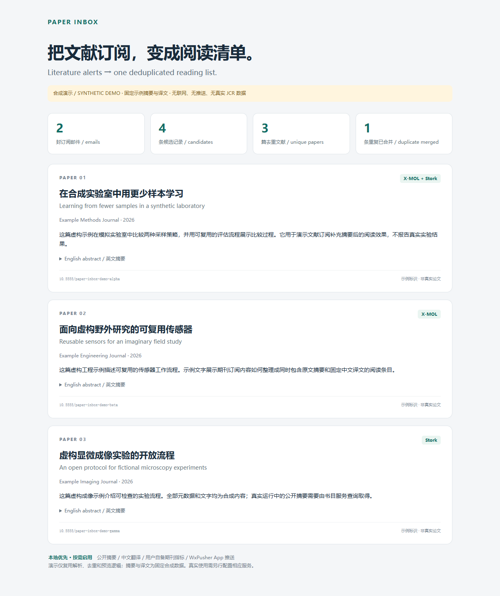

# Paper Inbox

**Turn X-MOL / Stork literature alert emails into a deduplicated reading list.**

Add public abstracts, Chinese translation, your own journal metrics and phone notifications as needed. The runtime uses the Python standard library and works without an AI agent.

[简体中文](README.md) · [Demo output](examples/demo-report.html) · [Setup](docs/SETUP.md) · [Agent Skill](skills/paper-inbox/SKILL.md)

[](https://github.com/AndyVict/paper-inbox/actions/workflows/ci.yml)



## Try it without credentials

With Python 3.11+, clone the repository and run:

```console
git clone https://github.com/AndyVict/paper-inbox.git
cd paper-inbox
python -X utf8 scripts/demo.py
```

Alternatively, download and extract the source ZIP from GitHub, then run the demo command inside the project directory.

Open `data/demo/report.html`. The demo runs the actual parsers and deduplication logic: **2 emails → 4 candidates → 3 papers**. Abstracts and translations are fixed fictional fixtures. It does not read `.env`, access the network, send notifications or touch the live database. A [Markdown sample](examples/demo-report.md) is also included.

## Features

- Parse X-MOL and Stork HTML/plain-text alerts.
- Deduplicate by DOI, PMID, then normalized title and year; retain provenance.
- Resume with SQLite cursors, cached enrichment and persistent delivery state.
- Optionally retrieve public abstracts from PubMed, Europe PMC, Crossref and OpenAlex.
- Optionally translate English titles and abstracts through NiuTrans, with caching and chunking.
- Optionally import your own journal metrics and match by verified ISSN/eISSN. No JCR database is distributed.
- Optionally notify through WxPusher App. Platform acceptance and user-confirmed receipt are separate states; uncertain sends are not replayed automatically.

## Install

Run from the repository root. On Windows PowerShell:

```powershell
python -m venv .venv
.\.venv\Scripts\python.exe -m pip install -e .
.\.venv\Scripts\paper-inbox.exe --help
if (Test-Path -LiteralPath .env) { throw 'config_already_exists' }
Copy-Item -LiteralPath .env.example -Destination .env
```

On macOS / Linux:

```console
python3 -m venv .venv
.venv/bin/python -m pip install -e .
.venv/bin/paper-inbox --help
```

Create `.env` from `.env.example` only for a fresh setup; preserve an existing file. Fill in `IMAP_*`, then run `paper-inbox sync --check-config` and `paper-inbox sync --fetch --max-mails 20` using the executable inside your virtual environment. Read Markdown outputs in `data/outbox/`.

```console
paper-inbox weekly --fetch
paper-inbox weekly --fetch --stages sync,abstracts,translation,delivery --language zh
paper-inbox send --status
```

The first command uses `sync,abstracts,delivery` and English previews. The second requires NiuTrans configuration and generates Chinese previews. Neither sends notifications. `--stages` selects stages; execution follows the canonical dependency order. Disabled stages do not load their service configuration.

`weekly` defaults to English; the standalone `send` command defaults to Chinese. Use `send --language en` for untranslated content. `--fetch` enables online retrieval; `--send` explicitly enables delivery. A bare `weekly` uses local data and caches only.

See [setup and delivery confirmation](docs/SETUP.md) before enabling notifications or scheduling. The detailed setup guide is currently Chinese; command names and error codes are unchanged.

## Compatibility and maturity

- Python metadata allows 3.11+. All eight Windows/Linux CI combinations on 3.11–3.14 have passed 269 tests each. See [release status](docs/RELEASE_STATUS.md) for evidence and Actions for the latest run.
- Configurable TLS IMAP host, port and ASCII mailbox names, with password/app-password authentication. 163 has live validation; other providers have mocked coverage only. OAuth2 is not implemented.
- Phone delivery targets WxPusher App. Personal WeChat delivery is subject to the provider's binding/activation requirements and is not promised as unattended delivery.
- This is a `0.1.0` release candidate. The manual end-to-end workflow has been used; the first scheduled weekly acceptance is still pending. Windows Task Scheduler export/registration is provided; other scheduling systems are not validated.

## Agent Skill and contributions

The [paper-inbox Skill](skills/paper-inbox/SKILL.md) guides setup, previews, status checks and troubleshooting. Install its folder in a client supporting Agent Skills and install the Python tool separately. Client compatibility is described in [docs/SKILL.md](docs/SKILL.md).

Contributions with synthetic fixtures, parser improvements and documentation are welcome. Read [CONTRIBUTING.md](CONTRIBUTING.md), [SECURITY.md](SECURITY.md) and [PROVENANCE.md](PROVENANCE.md).

```console
python -X utf8 -m unittest discover -s tests -q
python -X utf8 scripts/check_release.py
```

Code and synthetic examples are [MIT licensed](LICENSE). External services and user-provided datasets retain their own terms.
